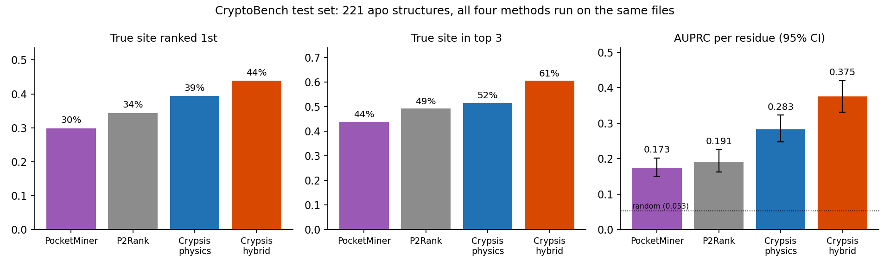

# Crypsis

**Find the binding pockets a protein structure is hiding.**

[](LICENSE)
[](https://www.python.org)


*Crypsis* is the biological term for an organism avoiding detection. **Cryptic pockets** do something similar:
they are closed or absent in the apo crystal structure, then open when the protein moves or a ligand binds. Many
targets once called "undruggable" have one, for example the switch-II pocket of K-Ras G12C, the target of
sotorasib.

Crypsis starts from a single structure and keeps the physics explicit at every step:

1. It computes the slow, collective motions of the fold with an elastic network model.
2. It builds an ensemble of conformers along those motions.
3. In each conformer it finds buried, probe-accessible pocket space on a C++ grid.
4. A gradient-boosted model, optionally combined with ESM-2 protein-language-model embeddings, turns these
   descriptors into a probability for every residue.

Each predicted site comes with its pocket volume in the input structure and along the motions. The volumes tell
you whether the pocket is **already open**, **grows with motion** or **forms with motion**. Each site also comes
with a ready-made docking box.

```
$ crypsis predict 4ldj.cif --chains A --keep GDP,MG
crypsis hybrid model, 170 residues, 2 sites (3 s)
rank  score   n  kind               volume A3 (structure -> ensemble)  residues
   1   1.84   5  forms with motion  9 -> 23                            Ser39 Leu56 Thr58 Ala59 Gly60
   2   1.58   5  forms with motion  12 -> 27                           Lys5 Arg68 Tyr71 Thr74 Gly75
```

This run is on K-Ras G12C with GDP bound but no drug (PDB 4LDJ). The switch-II pocket, where sotorasib binds, is
ranked first.

---

## Contents

- [Highlights](#highlights)
- [Requirements](#requirements)
- [Installation](#installation)
- [Quick start](#quick-start)
- [Benchmarks](#benchmarks)
- [Speed and memory](#speed-and-memory)
- [How it works](#how-it-works)
- [Limitations](#limitations)
- [Citing](#citing)

## Highlights

- **More accurate than the reference tools on the same structures.** On the CryptoBench test set, the residue
  ROC AUC is 0.881 against 0.788 for P2Rank and 0.762 for PocketMiner. The AUPRC is about twice theirs.
- **Explainable.** Each site is a real pocket on a grid, with a measured volume in the structure and along the
  motions, not just a residue score.
- **Fast.** 2–7 s per protein on a laptop CPU with the C++ grid.
- **Light.** The physics model needs only NumPy, SciPy and gemmi. PyTorch is needed only for the hybrid model.
- **Handles cofactors.** Bound GDP, heme, NAD and similar groups can be kept as occupied space, so removing them
  does not create a fake pocket.
- **Ready for the next step.** Every site comes with a docking box, a PDB coloured by probability and a PyMOL
  script.

## Requirements

| | Minimum | Notes |
|---|---|---|
| Operating system | macOS or Linux | Windows is untested; the NumPy fallback should run there |
| Python | 3.9+ | tested on 3.11 and 3.12 |
| Core dependencies | `numpy`, `scipy`, `gemmi` | installed automatically |
| C++ compiler (optional) | any C++17 compiler | macOS: `xcode-select --install`; Linux: `g++`. Without one, Crypsis uses the NumPy grid, which gives the same results about 5–15× more slowly |
| Hybrid model (optional) | `torch`, `fair-esm` | `pip install "crypsis[esm]"`; downloads the ESM-2 150M weights (about 600 MB) on first use |
| Memory | about 0.3 GB for the physics model, about 1.6 GB for the hybrid model | for a 1,000-residue protein |
| GPU | not needed | ESM-2 can use `--device cuda` or `--device mps` |

## Installation

**With the hybrid model** (recommended):

```bash
pip install "crypsis[esm] @ git+https://github.com/juvenalyosa/crypsis"
```

**Physics model only**, with no PyTorch:

```bash
pip install "git+https://github.com/juvenalyosa/crypsis"
```

**In a new conda environment:**

```bash
conda create -n crypsis python=3.12 -y
conda activate crypsis
pip install "crypsis[esm] @ git+https://github.com/juvenalyosa/crypsis"
```

**From source, for development:**

```bash
git clone https://github.com/juvenalyosa/crypsis
cd crypsis
pip install -e ".[esm,test]"
pytest
```

**Check the installation:**

```console
$ crypsis check
C++ grid extension: yes
ESM-2 (hybrid model): yes
```

If the C++ grid extension shows `no`, install a compiler and reinstall with `pip install --force-reinstall
--no-deps ...`. Until then, Crypsis works with the NumPy fallback.

## Quick start

### Command line

```bash
crypsis predict structure.cif                       # all protein chains, best available model
crypsis predict 1dlo.cif --chains A,B               # a heterodimer
crypsis predict 4ldj.cif --keep GDP,MG              # keep bound cofactors as occupied space
crypsis predict 4ldj.cif --keep auto                # ... or every hetero group of >= 8 heavy atoms
crypsis predict structure.pdb --model physics       # hybrid | physics | v1
crypsis predict structure.pdb --device mps          # ESM-2 on an Apple GPU (or cuda)
```

| Option | Default | Meaning |
|---|---|---|
| `--chains A,B` | all protein chains | chains to analyse together |
| `--keep auto` or `--keep GDP,MG` | none | cofactors kept as occupied, unscored space |
| `--model` | `auto` | `hybrid` when PyTorch and fair-esm are installed, otherwise `physics`; `v1` is the 3-weight logistic model |
| `--device` | `cpu` | PyTorch device for ESM-2 |
| `-o DIR` | `crypsis_out` | output folder |
| `--top N` | 5 | number of sites to print |

The input can be a PDB or mmCIF file, gzipped or not. Each run writes four files:

| File | Contents |
|---|---|
| `<name>_residues.csv` | each residue's probability, how often a pocket opened next to it in the ensemble, and its site |
| `<name>_sites.json` | ranked sites: residues, kind, pocket volumes, mean probability and a docking box (`center`, `size` in Å) |
| `<name>_crypsis.pdb` | the input structure with each B-factor set to 100 × probability |
| `<name>_crypsis.pml` | a PyMOL script that colours the structure by probability and shows the top three sites |

`examples/kras_g12c.sh` downloads 4LDJ and runs the prediction; then load `kras_out/4LDJ_crypsis.pml` in PyMOL.

### Python

```python
import crypsis

res = crypsis.predict("4ldj.cif", chains=["A"], keep_cofactors={"GDP", "MG"})
print(res["model"])                      # "hybrid", or "physics" without PyTorch
for site in res["sites"][:3]:
    print(site["rank"], site["kind"], site["residues"], site["docking_box"])

prob = dict(zip(res["residues"], res["probability"]))   # {"A_12": 0.31, ...}
```

If you already have ESM-2 150M embeddings (layer 30, a `[n_residues, 640]` array), pass them as `embeddings=`.

### Keep the cofactors

When a tightly bound cofactor (GDP, heme, NAD, ATP…) is deleted, it leaves an empty, perfectly shaped hole. That
hole then outranks the real cryptic site. With `--keep`, the cofactor counts as occupied space, moves with its
nearest residue in the ensemble, and is not scored. On K-Ras G12C, the switch-II pocket is ranked first only when
GDP is kept.

## Benchmarks

All models were trained and tuned on the CryptoBench training folds only. CryptoBench (Škrhák et al., 2025)
contains apo structures whose cryptic sites are known from holo structures. P2Rank 2.5.1 and PocketMiner were run
by us on exactly the same files.

### CryptoBench test set

The table covers the 221 apo structures (73,400 residues) on which every method ran. AUC and AUPRC are per
residue, with 95% bootstrap confidence intervals over proteins. The site columns give the share of proteins whose
true cryptic site is the first, or among the first three, predicted sites.

| Method | ROC AUC [95% CI] | AUPRC [95% CI] | Median AUC per protein | True site ranked 1st | True site in top 3 |
|---|---|---|---|---|---|
| **Crypsis hybrid** (physics + ESM-2) | **0.881** [0.863–0.897] | **0.375** [0.331–0.420] | **0.919** | **44%** | **61%** |
| Crypsis physics | 0.846 [0.825–0.867] | 0.283 [0.248–0.323] | 0.888 | 39% | 52% |
| Crypsis v1 (3-weight logistic) | 0.806 [0.785–0.827] | 0.180 [0.151–0.220] | 0.863 | 35% | 51% |
| P2Rank 2.5.1 | 0.788 [0.769–0.805] | 0.191 [0.163–0.226] | 0.832 | 34% | 49% |
| PocketMiner | 0.762 [0.738–0.783] | 0.173 [0.149–0.202] | 0.820 | 30% | 44% |

The hybrid model's AUC advantage, computed from paired bootstrap resamples, is:

| Compared with | AUC difference [95% CI] |
|---|---|
| PocketMiner | +0.119 [0.091–0.148] |
| P2Rank | +0.093 [0.068–0.117] |
| Crypsis physics | +0.034 [0.008–0.060] |

A residue picked at random is a cryptic-site residue 5.3% of the time, so that is the AUPRC of a random
predictor.

<p align="center"></p>

On all 222 test structures (74,046 residues), the hybrid model reaches an AUC of 0.881 [0.862–0.897] and an
AUPRC of 0.372 [0.328–0.415]. Per protein, the hybrid model has both the fewest failures and the most
near-perfect predictions:

| Model | Proteins with AUC < 0.6 | Proteins with AUC > 0.9 |
|---|---|---|
| Crypsis v1 | 13.5% | 43.7% |
| Crypsis physics | 17.1% | 46.4% |
| Crypsis hybrid | **12.6%** | **56.3%** |

### Independent benchmark: the PocketMiner set

These proteins come from the PocketMiner paper (Meller et al., 2023). The labels are pooled as in that paper:
pocket residues are positives, and residues of negative-example proteins are negatives.

| Method | Test set, 35 proteins | Test proteins unseen in CryptoBench training, 23 | Validation set, 26 proteins |
|---|---|---|---|
| **Crypsis hybrid** | **0.907** [0.862–0.945] | **0.878** [0.819–0.930] | 0.843 [0.680–0.935] |
| Crypsis physics | 0.879 [0.820–0.935] | 0.848 [0.775–0.920] | 0.808 [0.590–0.925] |
| PocketMiner | 0.868 [0.783–0.935] | 0.852 [0.722–0.945] | **0.897** [0.840–0.955] |
| P2Rank | 0.624 [0.528–0.717] | 0.645 [0.528–0.758] | 0.679 [0.544–0.898] |

PocketMiner's own value on its test set (0.87) is reproduced. PocketMiner used the validation set for model
selection, which favours it in the last column. On the unseen subset the confidence intervals overlap.

### Eight cryptic sites from the literature

None of these proteins is in the CryptoBench training set. Each cell gives the AUC within the protein and the
rank of the first predicted site that matches the true one. For P2Rank and PocketMiner, the K-Ras row is without
GDP, since those tools cannot keep a cofactor.

| Protein (apo → holo) | Site, as described in the literature | P2Rank | PocketMiner | Crypsis hybrid | Kind reported by Crypsis |
|---|---|---|---|---|---|
| K-Ras G12C + GDP (4LDJ → 6OIM) | switch-II pocket (sotorasib) | 0.76, #1 | 0.64, #1 | 0.83, **#1** | forms with motion |
| TEM-1 β-lactamase (1ZG4 → 1PZO) | opens when helices 11/12 separate | 0.64, #1 | 0.89, #1 | 0.73, **#1** | forms with motion |
| BCL-xL (1MAZ → 2YXJ) | BH3 groove (ABT-737) | 0.74, #1 | 0.65, #2 | 0.80, **#1** | forms with motion |
| MDM2 (1Z1M → 1RV1) | p53 cleft (nutlin) | 0.88, #1 | 0.56, not found | 0.90, **#1** | forms with motion |
| Glucokinase (1V4T → 1V4S) | allosteric activator site, absent in the super-open form | 0.51, not found | 0.80, #1 | 0.80, #4 (physics: 0.92, #1) | forms with motion |
| PTP1B (2CM2 → 1T49) | needs helix α7 to unfold | 0.65, not found | 0.44, not found | 0.38, not found | – |
| p38α (1WFC → 3HVC) | C-lobe lipid pocket | 0.52, not found | 0.61, not found | 0.41, not found | – |
| HIV-1 RT (1DLO → 1VRT) | NNRTI pocket: Tyr181 and Tyr188 rotate | 0.76, not found | 0.65, not found | 0.63, not found | – |

No method wins every case. Where Crypsis finds the site, the kind it reports ("forms with motion") agrees with the
opening mechanism described in the literature. The three sites that every method misses are the ones that need
unfolding, side-chain rotations or a site absent from the apo crystal.

## Speed and memory

These are wall-clock times for the whole command (reading, ensemble, grid, model and output) on an Apple M4
laptop CPU, with one process per structure. The hybrid times include loading ESM-2 from the local cache.

| Protein | Residues | Physics, C++ grid | Physics, NumPy grid | Hybrid, C++ grid | Peak memory (physics / hybrid) |
|---|---|---|---|---|---|
| Lysozyme (2LZT) | 129 | 1.7 s | 9.3 s | 3.3 s | 0.11 / 1.39 GB |
| TEM-1 (1ZG4) | 263 | 1.5 s | – | 3.0 s | 0.12 / 1.41 GB |
| Glucokinase (1V4T) | 424 | 2.3 s | 28 s | 3.9 s | 0.17 / 1.44 GB |
| HIV-1 RT heterodimer (1DLO) | 971 | 4.4 s | – | 6.9 s | 0.32 / 1.57 GB |

## How it works

1. **Motions.** An anisotropic network model is built on the Cα atoms (15 Å cutoff, sparse Hessian). Its 30
   lowest non-trivial modes are kept.
2. **Ensemble.** 24 conformers are random thermal combinations of those modes, each scaled to a Cα RMSD of 3 Å.
   Side chains and kept cofactors move with their residue.
3. **Pocket grid (C++).** On a 1 Å grid, a point is a pocket point when two conditions hold:
   - a water-sized probe fits there;
   - at least 70% of 30 rays meet protein within 10 Å.

   A second, shallower pass uses 55% of the rays. Connected points form pockets, and each residue gets the score
   of the best pocket it lines.
4. **Descriptors.** For each residue, Crypsis computes:
   - pocket volume and score in the structure and across the ensemble;
   - how often a pocket opens next to the residue, and how much it gains;
   - burial, hydrophobicity, B-factor and mode mobility;
   - patch averages of these values.

   The descriptors are rank-normalized within the protein and smoothed over the residue contact graph (8 Å,
   σ = 4 Å). An amino-acid propensity is added, giving 22 columns in total.
5. **Models.**

   | Model | Inputs | Learner | Test AUC |
   |---|---|---|---|
   | `hybrid` | 22 physics columns + 128 principal components of the ESM-2 150M embeddings | gradient-boosted trees | 0.881 |
   | `physics` | 22 physics columns | gradient-boosted trees | 0.846 |
   | `v1` | 3 ensemble descriptors | logistic regression | 0.807 |

6. **Sites.** The top 10% of residues are grouped into sites by Cα proximity (6.5 Å links, within 12 Å of the
   seed residue). Sites are ranked by summed probability. Each site's kind compares its pocket volume in the
   structure with its volume in the ensemble.

The trees are shipped as plain arrays (`src/crypsis/models/*.npz`) and evaluated by a small NumPy evaluator. There
is no pickle and no scikit-learn at prediction time. `scripts/export_models.py` documents the export and checks
that the evaluator reproduces scikit-learn's probabilities exactly.

**Reproducibility.** The sign of each normal mode is arbitrary, and the LAPACK build decides it. If PyTorch is
imported before Crypsis computes the modes, a few modes can flip sign. That slightly changes the sampled ensemble
and therefore the probabilities. Crypsis imports PyTorch only after the physics is done. For numbers identical to
the published ones, run each structure in a fresh process, as the command line does.

## Limitations

- **Very large rearrangements.** Sites that open only through partial unfolding (PTP1B helix α7), large
  side-chain rotations (HIV-1 RT NNRTI pocket), or that are absent from the apo crystal structure (p38α lipid
  pocket) are missed. So are they by P2Rank and PocketMiner.
- **Elastic-network motions.** The ensemble is approximate and only fast to compute; it is not molecular
  dynamics. Use the predicted docking box as a starting point for docking or simulations.
- **Probabilities rank residues within a protein.** Compare sites within one structure, not absolute
  probabilities across proteins.

## Also in Leonardo

Crypsis was developed in [Leonardo](https://github.com/juvenalyosa/Leonardo), an open-source molecular modelling
suite for PyMOL, and it is also built in there. In Leonardo the method has a graphical window and an AI-agent
tool, and the predicted docking box goes straight into docking or molecular dynamics.

## Citing

A manuscript describing Crypsis is in preparation; see `CITATION.cff`. Please also cite the work Crypsis builds
on:

- Škrhák, V., Novotný, M., Feidakis, C. P., Krivák, R., & Hoksza, D. (2025). CryptoBench: Cryptic protein–ligand
  binding sites dataset and benchmark. *Bioinformatics, 41*(1), btae745. https://doi.org/10.1093/bioinformatics/btae745
- Lin, Z., et al. (2023). Evolutionary-scale prediction of atomic-level protein structure with a language model.
  *Science, 379*(6637), 1123–1130. https://doi.org/10.1126/science.ade2574
- Atilgan, A. R., et al. (2001). Anisotropy of fluctuation dynamics of proteins with an elastic network model.
  *Biophysical Journal, 80*(1), 505–515. https://doi.org/10.1016/S0006-3495(01)76033-X

The tools in the comparison are:

- Krivák, R., & Hoksza, D. (2018). P2Rank. *Journal of Cheminformatics, 10*, 39.
  https://doi.org/10.1186/s13321-018-0285-8
- Meller, A., et al. (2023). PocketMiner. *Nature Communications, 14*, 1177.
  https://doi.org/10.1038/s41467-023-36699-3

## License

MIT. The ESM-2 weights are distributed by Meta under the MIT license.
